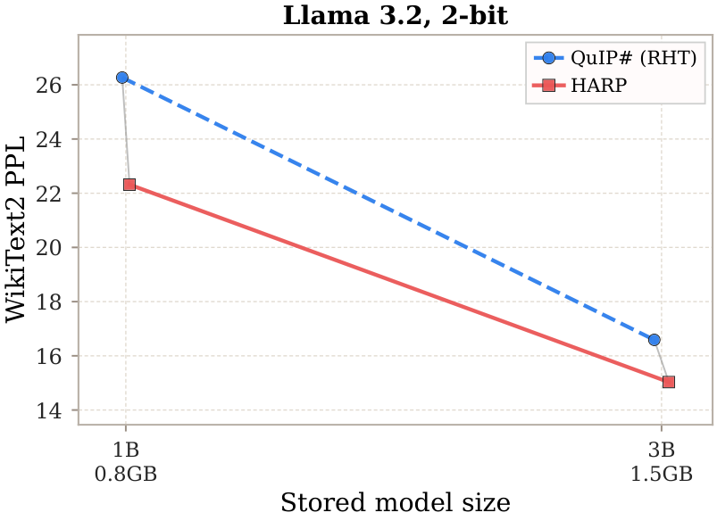
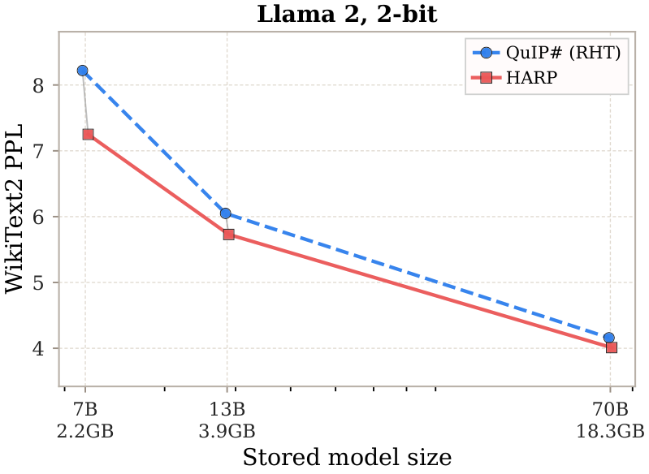

# HARP: Hadamard-Preconditioned Adaptive Rotations for Extreme LLM Quantization

<p align="center">
  
</p>

<p align="center">
  <a href="https://arxiv.org/abs/2605.29843"></a>&nbsp;
  <a href="https://huggingface.co/collections/brain-lab/harp-quantized-models"></a>&nbsp;
  
</p>


<p align="center">
  <b>Learnable orthogonal preprocessing for extreme LLM quantization</b>
</p>

> **TL;DR**
>
> HARP replaces the fixed randomized Hadamard transform used in SOTA PTQ pipelines with a learnable structured orthogonal processor trained only on calibration data. It improves quantization quality while preserving the original quantizer, deployment pipeline, and inference efficiency.

<p align="center">
  
  &nbsp;&nbsp;
  
</p>
<p align="center">
  <sub><b>WikiText2 quality–size scaling at 2 bits.</b> HARP uses int8 parameter storage. Plots split by model family to keep quality gaps visible across scales.</sub>
</p>

## What is HARP?

Modern ultra-low-bit quantization methods such as QuIP# rely on randomized orthogonal transforms (typically Randomized Hadamard Transforms, RHT) to improve weight incoherence before quantization.

HARP asks a simple question:

> **Can the incoherence processor itself be learned instead of fixed?**

To answer this, **HARP** (Hadamard-Preconditioned Adaptive Rotations) introduces a structured orthogonal processor that:

* starts from a Hadamard-style initialization,
* remains computationally efficient,
* is trained only during calibration,
* requires **no model retraining**,
* can be integrated into existing PTQ pipelines with minimal changes.

The resulting processor better adapts to the statistics of each layer, reducing quantization error while preserving the original backend workflow.

---

## Results

Perplexity (PPL ↓) for QuIP# with fixed RHT vs. HARP on Llama 2, at context length 4096. BPP includes HARP processor storage.

<table>
<thead>
<tr>
<th align="center" rowspan="2">Bits</th>
<th align="left" rowspan="2">Method</th>
<th align="center" colspan="3" style="border-left:2px solid #888; text-align:center;">Llama 2 7B</th>
<th align="center" colspan="3" style="border-left:2px solid #888; text-align:center;">Llama 2 13B</th>
<th align="center" colspan="3" style="border-left:2px solid #888; text-align:center;">Llama 2 70B</th>
</tr>
<tr>
<th align="right" style="border-left:2px solid #888;">BPP&nbsp;↓</th>
<th align="right">W2&nbsp;↓</th>
<th align="right">C4&nbsp;↓</th>
<th align="right" style="border-left:2px solid #888;">BPP&nbsp;↓</th>
<th align="right">W2&nbsp;↓</th>
<th align="right">C4&nbsp;↓</th>
<th align="right" style="border-left:2px solid #888;">BPP&nbsp;↓</th>
<th align="right">W2&nbsp;↓</th>
<th align="right">C4&nbsp;↓</th>
</tr>
</thead>
<tbody>
<tr style="border-top:2px solid #888;">
<td align="center">16</td><td>FP16</td>
<td align="right" style="border-left:2px solid #888;">16.00</td><td align="right">5.12</td><td align="right">6.63</td>
<td align="right" style="border-left:2px solid #888;">16.00</td><td align="right">4.57</td><td align="right">6.05</td>
<td align="right" style="border-left:2px solid #888;">16.00</td><td align="right">3.12</td><td align="right">4.97</td>
</tr>
<tr style="border-top:2px solid #888;">
<td align="center" rowspan="2">2</td><td>QuIP# (RHT)</td>
<td align="right" style="border-left:2px solid #888;">2.00</td><td align="right">8.22</td><td align="right">10.86</td>
<td align="right" style="border-left:2px solid #888;">2.00</td><td align="right">6.05</td><td align="right">8.06</td>
<td align="right" style="border-left:2px solid #888;">2.00</td><td align="right">4.16</td><td align="right">6.01</td>
</tr>
<tr>
<td><b>HARP</b></td>
<td align="right" style="border-left:2px solid #888;">2.06</td><td align="right"><b>7.25</b></td><td align="right"><b>9.51</b></td>
<td align="right" style="border-left:2px solid #888;">2.03</td><td align="right"><b>5.73</b></td><td align="right"><b>7.64</b></td>
<td align="right" style="border-left:2px solid #888;">2.02</td><td align="right"><b>4.01</b></td><td align="right"><b>5.82</b></td>
</tr>
<tr style="border-top:2px solid #888;">
<td align="center" rowspan="2">3</td><td>QuIP# (RHT)</td>
<td align="right" style="border-left:2px solid #888;">3.00</td><td align="right">5.61</td><td align="right">7.35</td>
<td align="right" style="border-left:2px solid #888;">3.00</td><td align="right">4.89</td><td align="right">6.49</td>
<td align="right" style="border-left:2px solid #888;">3.00</td><td align="right">3.40</td><td align="right">5.20</td>
</tr>
<tr>
<td><b>HARP</b></td>
<td align="right" style="border-left:2px solid #888;">3.06</td><td align="right"><b>5.52</b></td><td align="right"><b>7.21</b></td>
<td align="right" style="border-left:2px solid #888;">3.03</td><td align="right"><b>4.82</b></td><td align="right"><b>6.40</b></td>
<td align="right" style="border-left:2px solid #888;">3.02</td><td align="right"><b>3.35</b></td><td align="right"><b>5.16</b></td>
</tr>
<tr style="border-top:2px solid #888;">
<td align="center" rowspan="2">4</td><td>QuIP# (RHT)</td>
<td align="right" style="border-left:2px solid #888;">4.00</td><td align="right">5.27</td><td align="right">6.85</td>
<td align="right" style="border-left:2px solid #888;">4.00</td><td align="right">4.70</td><td align="right">6.20</td>
<td align="right" style="border-left:2px solid #888;">4.00</td><td align="right">3.22</td><td align="right">5.05</td>
</tr>
<tr>
<td><b>HARP</b></td>
<td align="right" style="border-left:2px solid #888;">4.06</td><td align="right"><b>5.24</b></td><td align="right"><b>6.81</b></td>
<td align="right" style="border-left:2px solid #888;">4.03</td><td align="right"><b>4.66</b></td><td align="right"><b>6.15</b></td>
<td align="right" style="border-left:2px solid #888;">4.02</td><td align="right"><b>3.20</b></td><td align="right"><b>5.02</b></td>
</tr>
</tbody>
</table>

HARP consistently improves W2/C4 perplexity over the fixed-RHT baseline at every bit-width and model size, at a negligible BPP overhead from processor storage.

---

## Repository layout

The repository is organized as a two-backend monorepo:

```text
.
├── harp_quip/   # QuIP# + HARP
└── harp_qtip/   # QTIP + HARP
```

Both integrations share the same high-level idea: set the backend's incoherence processor to `harp` instead of the original fixed Hadamard/RHT processor, fit HARP during calibration, and then export/evaluate the resulting quantized model using the backend's usual flow. Each subdirectory is a self-contained fork of the corresponding upstream codebase. Install and run each backend from inside its own folder.

---

## Which backend should I use?

Use `harp_quip/` for the main QuIP# experiments, including the paper's primary RHT-vs-HARP comparisons.

Use `harp_qtip/` for the QTIP integration / portability experiment. The HARP module is conceptually the same, but QTIP uses a different trellis-coded quantization backend and its own kernels.

---

## Quick start

### QuIP# + HARP

```bash
cd harp_quip
pip install -r requirements.txt
cd quiptools
python setup.py install
cd ..
```

Then see `harp_quip/README.md` and the scripts under `harp_quip/harp_scripts/`.

### QTIP + HARP

```bash
cd harp_qtip
pip install -r requirements.txt
cd qtip-kernels
python setup.py install
cd ..
```

Then see `harp_qtip/README.md` and the scripts under `harp_qtip/harp_scripts/`.

---

## Main HARP flags

Both backend integrations expose HARP through the incoherence-processing flag:

- `--incoh_mode harp`: use HARP.
- `--incoh_mode had`: use the original fixed Hadamard/RHT processor.

Common HARP options include:

- `--harp_steps`: number of HARP fitting steps per layer/module.
- `--harp_b`, `--harp_max_b`: preferred and maximum radix for mixed-radix stages.
- `--harp_passes`: number of HARP passes.
- `--harp_ordering_mode stride`: stride-order staged execution.
- `--harp_fixed_mixer had_or_qr`: Hadamard for power-of-two blocks, deterministic QR fallback otherwise.
- `--harp_lr_u`, `--harp_lr_v`: learning rates for the two-sided HARP processors.
- `--harp_hbd_lambda`, `--harp_hbd_block`: Hessian block-diagonalization regularizer settings.

Backend-specific flags and scripts are documented in the corresponding subdirectory README.

---

## Notes on calibration and Hessian statistics

HARP is fit during calibration. This adds a one-time quantization cost but does not require retraining the full model. Hessian / second-moment statistics can be generated once per base model and reused across RHT and HARP runs, as well as across hyperparameter sweeps.

Calibration cost differs by backend. QuIP# + HARP is the primary integration used for the main experiments. QTIP + HARP is currently a portability integration and can be slower because QTIP's trellis-coded quantization target is more expensive to refresh during HARP fitting.

---

## Citation

If you use HARP in your research, please cite:

```bibtex

@article{zagitov2026harp,
  title={HARP: Hadamard-Preconditioned Adaptive Rotation Processor for Extreme LLM Quantization}, 
  author={Artur Zagitov and Gleb Molodtsov and Aleksandr Beznosikov},
  year={2026},
  eprint={2605.29843},
  archivePrefix={arXiv},
  primaryClass={cs.LG},
  url={https://arxiv.org/abs/2605.29843}, 
}
```
---

## Licenses and model terms

Each backend folder inherits the license of the corresponding upstream project. Model weights and tokenizers remain governed by their original licenses, for example the Meta Llama license for Llama models.
